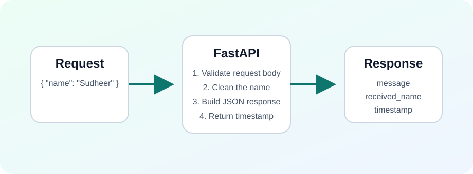
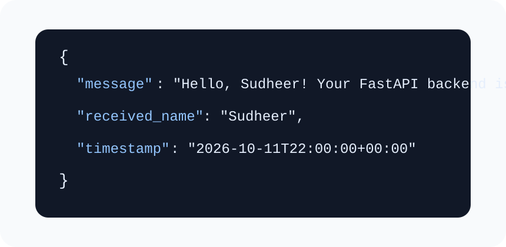

# FastAPI backend repository

This repository contains a basic FastAPI service with one main API endpoint:

- `POST /api/greet`

It accepts a name and returns a greeting message in JSON format.

## Pictures

### Backend flow



### Example API response



## Project structure

```text
backend-fastapi/
├── app/
│   ├── main.py
│   └── schemas.py
├── docs/
├── Dockerfile
└── requirements.txt
```

## API details

### Request

`POST /api/greet`

```json
{
  "name": "Sudheer"
}
```

### Response

```json
{
  "message": "Hello, Sudheer! Your FastAPI backend is working.",
  "received_name": "Sudheer",
  "timestamp": "2026-10-11T22:00:00+00:00"
}
```

## Local setup

### 1) Create a virtual environment

```bash
python3 -m venv .venv
source .venv/bin/activate
```

### 2) Install dependencies

```bash
pip install -r requirements.txt
```

### 3) Run the server

```bash
uvicorn app.main:app --reload
```

Open:

- API docs: `http://localhost:8000/docs`
- Health check: `http://localhost:8000/health`

## CORS configuration

The backend allows these local frontend origins by default:

- `http://localhost:5173`
- `http://127.0.0.1:5173`
- `http://localhost:8080`
- `http://127.0.0.1:8080`

When you deploy the frontend, provide its real URL using `FRONTEND_ORIGINS`.

Example:

```bash
export FRONTEND_ORIGINS="https://your-frontend-domain.com"
```

For multiple origins:

```bash
export FRONTEND_ORIGINS="https://your-frontend-domain.com,https://another-domain.com"
```

## Test the API quickly

```bash
curl -X POST http://localhost:8000/api/greet \
  -H "Content-Type: application/json" \
  -d '{"name":"Sudheer"}'
```

## Build the backend container

```bash
docker build -t basic-fastapi-backend .
```

Run it locally:

```bash
docker run --rm -p 8080:8080 \
  -e FRONTEND_ORIGINS="http://localhost:5173" \
  basic-fastapi-backend
```

## Deploy to Cloud Run

Example using Google Cloud:

```bash
gcloud run deploy basic-fastapi-backend \
  --source . \
  --region us-central1 \
  --allow-unauthenticated \
  --set-env-vars FRONTEND_ORIGINS=https://your-frontend-domain.com
```

## Learning notes

- `app/schemas.py` defines the request and response shapes.
- `app/main.py` wires FastAPI, CORS, and the endpoint together.
- `/health` is a simple endpoint you can use for uptime checks.
